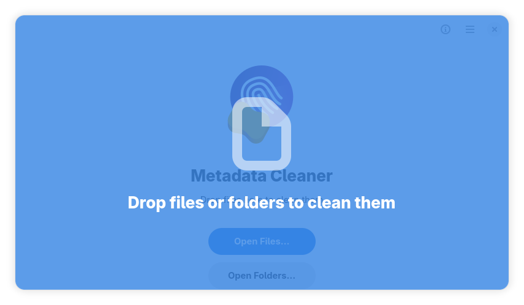

<p align="center">
  
</p>

<h1 align="center">Metadata Cleaner for Windows</h1>

<p align="center">
  <strong>See what your files carry. Remove it before you share them.</strong><br>
  A native Windows 10/11 port of the GTK4 Metadata Cleaner.
</p>

<p align="center">
  <a href="https://github.com/rvisas/metadatacleaner-windows/actions/workflows/tests.yml">
    
  </a>
  <a href="https://github.com/rvisas/metadatacleaner-windows/releases">
    
  </a>
  <a href="LICENSE">
    
  </a>
  <a href="https://github.com/rvisas/metadatacleaner-windows/actions/workflows/codeql.yml">
    
  </a>
  
</p>

<p align="center">
  <a href="https://github.com/rvisas/metadatacleaner-windows/releases">
    
  </a>
</p>

<p align="center">
  <a href="DOWNLOAD.md">Download</a>
  &nbsp;·&nbsp;
  <a href="docs/build.md">Build from source</a>
  &nbsp;·&nbsp;
  <a href="SUPPORT.md">Support</a>
  &nbsp;·&nbsp;
  <a href="https://github.com/rvisas/metadatacleaner-windows/issues">Report a bug</a>
</p>

<p align="center">
  
  <br>
  <sub>The upstream GTK4/libadwaita interface; the Windows port preserves it. Screenshot: CC-BY-SA-4.0.</sub>
</p>

> [!WARNING]
> The current installer is unsigned while the SignPath Foundation application
> is being prepared, so Windows SmartScreen may warn on first launch. Verify
> the SHA-256 checksum before running it; see
> [`docs/code-signing.md`](docs/code-signing.md) for the signing process.

## At a glance

| At a glance | |
|---|---|
| **Platform** | Windows 10 2004+ and Windows 11, x64 |
| **Interface** | GTK4 + libadwaita, native Windows build |
| **Cleaning engine** | [mat2](https://github.com/jvoisin/mat2) 0.15 |
| **Installer** | Inno Setup, per-user by default |
| **License** | GPL-3.0-or-later |

## Why this exists

I have used Metadata Cleaner for years on Linux. It was one of the first tools
I installed on a new machine: a small, focused app that showed me what a file
was carrying and let me remove it before sending the file to someone else.

When my work brought me back to Windows 11, I could not find the same
experience. There were other tools, but none felt like the application I had
used for years. So I built the version I was missing: the same GTK workflow,
running natively on Windows, with the same cleaning engine underneath.

This repository is that port. It is deliberately kept close to the maintained
[upstream project](https://gitlab.com/metadatacleaner/metadatacleaner) so it can
follow new releases instead of drifting into a separate product.

## Features

- **Inspect before you clean.** Open a file and see exactly which metadata
  fields it contains; nothing is removed until you ask.
- **Thorough by default.** The port uses mat2's thorough cleaning mode, which
  removes the largest set of metadata rather than only the obvious fields.
- **Files or folders.** Add individual files, whole directories or drag and
  drop them into the window. Batch cleaning works the same way.
- **A native GTK4 app, not a wrapper.** The interface is the upstream
  libadwaita application, packaged with its own Python and GTK runtime.
- **Offline by design.** No account, telemetry or upload; the files never leave
  the machine.
- **One installer.** The Inno Setup package includes the app, the runtime,
  exiftool and ffmpeg, and registers an uninstaller.

## Install

### Requirements

- Windows 10 version 2004 (build 19041) or newer, or Windows 11.
- x64. ARM64 is not supported yet.
- No separate Python, GTK or MSYS2 installation is needed.

### Download

1. Open the [Releases page](https://github.com/rvisas/metadatacleaner-windows/releases)
   and download `MetadataCleaner-<version>-windows-x64-setup.exe`.
2. Download the matching `.sha256` file (or `SHA256SUMS.txt`).
3. Verify the installer in PowerShell before running it:

   ```powershell
   $version = "4.0.1.6"
   $asset = "MetadataCleaner-$version-windows-x64-setup.exe"
   Get-FileHash ".\$asset" -Algorithm SHA256
   Get-Content ".\${asset}.sha256"
   ```

   The two hashes must match (comparison is case-insensitive). If they do not,
   do not run the file.
4. Run the installer. It installs per-user by default; the privileges dialog
   can request an all-users installation.

> [!NOTE]
> The installer is not code-signed yet. SmartScreen's "unknown publisher"
> warning is expected until a signing provider is approved; see
> [`docs/code-signing.md`](docs/code-signing.md) for the options.
> The checksum is still a reliable way to confirm that the download is intact.

### Pinning to the taskbar

This build registers a stable AppUserModelID and a shortcut icon, so the pinned
button launches `MetadataCleaner.exe` and keeps the application logo. If you
pinned an older build, unpin that icon once, install this version, and pin the
new **Metadata Cleaner** entry from the Start Menu. Pinning the running window
also works because both the window and the shortcut use the same AppUserModelID.

### Language

The installer and the application are available in **English** and **Spanish**
only. **Metadata Cleaner is a proper noun and is never translated.** The
application follows the language chosen in the setup wizard; if that value is
missing it falls back to the Windows display language, then to English.
`MC_LANGUAGE=es` (or `en`) overrides the choice for a single launch.

### Updating

The installer uses a stable application ID, so a newer installer updates the
existing installation in place. You do not need to uninstall the previous
version, and your settings and file list are kept. When a previous version is
detected, the welcome page shows the version being replaced and the new one.
The setup wizard is available in English and Spanish only.

The application also checks GitHub for a newer Windows installer once per day.
When one is available it shows **A new version is available** with an
**Update now** button; the download is verified against the release SHA-256
before the installer is started. Automatic checks can be disabled in
**Settings**, and **Check for Updates…** in the main menu performs an immediate
check.

## Usage

1. Open **Metadata Cleaner** from the Start Menu.
2. Add files or folders with the buttons, or drag them onto the window.
3. Select a file to inspect its metadata before cleaning.
4. Click **Clean** to remove the metadata from the selected files.

The app works on a temporary copy and replaces the original only when the
cleaning finishes. Keep backups of anything irreplaceable.

> [!NOTE]
> In thorough mode, PDFs can become larger because mat2 rebuilds the document
> and rasterizes its pages at higher resolution. That is expected: the goal is
> maximum metadata removal, not file-size reduction. Compression is a separate
> concern.

## Supported files

| Category | Formats |
|---|---|
| **Images** | JPEG, PNG, TIFF, WebP, AVIF, HEIC/HEIF, GIF, BMP |
| **Documents** | PDF, DOCX, XLSX, PPTX, ODT, ODS, ODP, EPUB |
| **Audio** | MP3, FLAC, OGG, WAV, M4A |
| **Video** | MP4, MKV, MOV, AVI, WebM |

Cleaning support comes from mat2. Video handling uses the bundled ffmpeg, and
some image formats use the bundled exiftool. Formats outside this table may
still work if mat2 supports them; the list is the tested set, not a hard limit.

## The Windows port

The app is the upstream GTK4 application, not a rewrite. The Windows delta is
kept small and reviewable. The repository intentionally excludes Linux desktop
integration, Flatpak, Flathub, AppStream and D-Bus packaging files; they are
not part of the Windows product:

- relocatable application paths and a native C launcher;
- Windows home-path, xattr, PDF URI/temp-file and archive-replacement fixes;
- a self-contained runtime with Python, GTK, poppler, exiftool and ffmpeg.

The patches live in [`patches/`](patches) and the exact changes are documented
in [`docs/upstream.md`](docs/upstream.md). The installer layout and launcher build are
described in [`installer/README.md`](installer/README.md).

## Code signing policy

**Free code signing provided by [SignPath.io](https://about.signpath.io),
certificate by [SignPath Foundation](https://signpath.org).**

The Windows launcher, the Inno Setup installer and the generated uninstaller
are the artifacts covered by this policy. Every production signing request
requires manual approval after the GitHub Actions build and origin check.

- **Authors / committers:** [@rvisas](https://github.com/rvisas)
- **Reviewers:** [@rvisas](https://github.com/rvisas)
- **Approvers:** [@rvisas](https://github.com/rvisas)

The full policy is in [`CODE_SIGNING_POLICY.md`](CODE_SIGNING_POLICY.md).
Privacy practices, including the optional GitHub update check, are documented
in [`PRIVACY.md`](PRIVACY.md). The signing process and current status are in
[`docs/code-signing.md`](docs/code-signing.md).

## Versioning

The version is derived from the upstream release, not chosen independently:

```text
MAJOR.MINOR.PATCH.PORT
4    .0    .1    .1
```

`4.0.1` is the upstream base; `.1` is the Windows port revision. Port-only
fixes increment the fourth component (`4.0.1.6` → `4.0.1.7`). When upstream publishes a new
release, the base changes and the port revision restarts at `.1`
(`4.0.2.1`). The port never publishes `4.0.2` unless upstream has published
4.0.2.

The canonical rules live in [`docs/versioning.md`](docs/versioning.md), with
[`version.json`](version.json) as the source of truth and
`python scripts/versioning.py check` verifying the build inputs. The upstream
update procedure is in [`docs/upstream.md`](docs/upstream.md), and agents must
follow both as recorded in [`AGENTS.md`](AGENTS.md).

## Build from source

The build uses MSYS2 UCRT64 and Inno Setup 6.3 or newer. The complete package
list, environment variables and troubleshooting notes are in
[`docs/build.md`](docs/build.md).

```bash
git clone https://github.com/rvisas/metadatacleaner-windows.git
cd metadatacleaner-windows
BUILD_ROOT="$TMPDIR/metadata-cleaner-build" bash scripts/build-windows.sh
iscc /DAppVersion=4.0.1.6 \
  /DPayloadDir="$TMPDIR/metadata-cleaner-build\payload" \
  /DOutputDir="$TMPDIR/metadata-cleaner-build\installer" \
  installer\metadatacleaner.iss
```

`scripts/build-windows.sh` builds the portable payload in `BUILD_ROOT` and
Inno Setup writes the installer there too. Neither is committed, and the
release workflow runs the same steps in GitHub Actions to publish the asset.

## Tests and releases

The test suite covers release naming and SHA-256 generation, the Windows patch
guardrails, folder imports, Spanish/English localization, the update selector,
and the native launcher integration:

```bash
python -m unittest discover -s tests -v
```

The release workflow also builds the payload, runs the folder-import test
against that exact payload, and only then compiles and publishes the installer.

## Documentation

- [Architecture](docs/architecture.md): runtime layers and module map.
- [Versioning](docs/versioning.md): upstream base plus port revision.
- [Upstream tracking](docs/upstream.md): how new upstream releases are applied.
- [Code signing](docs/code-signing.md): SignPath Foundation application, release signing and fallback options.
- [SignPath application prep](docs/signpath-application.md): field-by-field values for the live form.
- [Agent instructions](AGENTS.md): repository rules for AI-assisted changes.
- [Support](SUPPORT.md): where to report bugs, security issues and upstream problems.
- [Governance](GOVERNANCE.md): maintainer roles and signing approval.
- [Threat model](THREAT_MODEL.md): security and privacy boundaries.
- [Incident response](INCIDENT_RESPONSE.md): how a security or release incident is handled.
- [Repository standards](docs/repository-standards.md): how the layout maps to high-visibility OSS projects.
- [Roadmap](ROADMAP.md): direction without release-date promises.

## Contributing

Issues and pull requests are welcome. Because this is a port, the most useful
contributions keep the Windows-specific delta small:

- report Windows-specific bugs with the file type, Windows version and the
  exact error;
- discuss upstream behaviour in the upstream project first;
- keep patches in `patches/` and update [`docs/upstream.md`](docs/upstream.md) when the
  delta changes.

For general project conventions, see [`CONTRIBUTING.md`](CONTRIBUTING.md).

## License

GPL-3.0-or-later, the same license as upstream. See [`LICENSE`](LICENSE) and
[`LICENSES/`](LICENSES).

Metadata Cleaner, its name and its artwork belong to the upstream
contributors. The screenshots are CC-BY-SA-4.0. mat2 is LGPL-3.0; exiftool,
poppler and ffmpeg keep their own licenses.

This is an unofficial port, not affiliated with or endorsed by the upstream
maintainers. Metadata removal is best-effort: no tool can guarantee that every
identifying byte, watermark or derived signal has been removed. Inspect
important files before publishing them.

<p align="center">
  <sub>Unofficial Windows port · Built with GTK4, libadwaita and mat2</sub>
</p>
